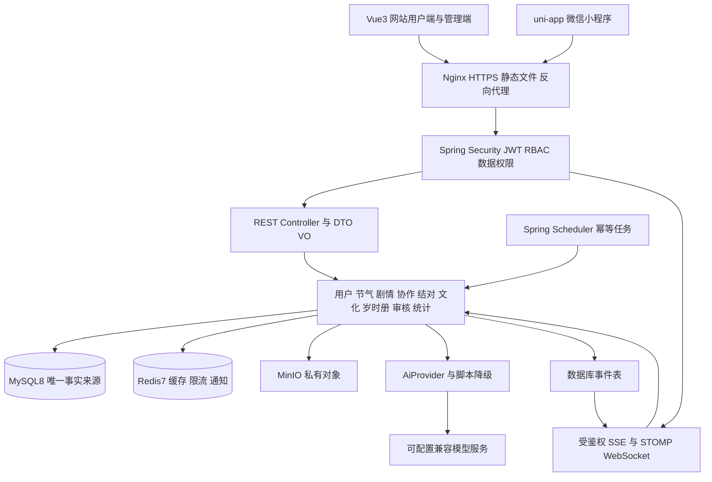
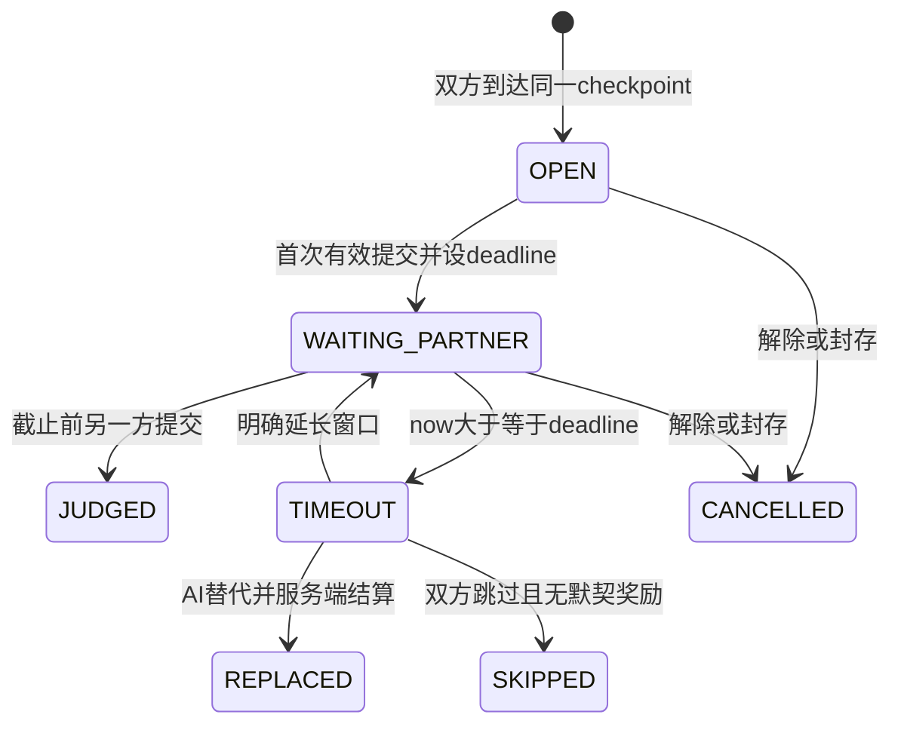

# 岁时同行系统架构与设计决策

完整目标架构基线，2026-10-28。阶段1身份基础与立春剧情引擎已实现，其他部分为后续目标。实际范围及版本、幂等、私有提交等调整见[剧情说明](story-engine.md)；下文保留完整目标，不代表全部完成。

当前补充：小满AI伙伴与管理/审校接口已实现，边界和测试见[AI说明](ai-companion.md)，未验收第三方付费模型或生产部署。

## 1. 架构选择

采用模块化单体：一个 Spring Boot 应用、一个 MySQL 业务库，以包和服务接口隔离领域。网站用户端与管理端共用一个 Vue 工程，分别使用 `/` 和 `/admin` 布局；小程序独立 uni-app 工程，共用契约与后端。不引入服务注册、消息中间件或分布式事务。



Redis 不存唯一存档与唯一答案，WebSocket 不是完成判定的依据。事务提交后的事件可丢失重试，客户端始终能从 REST 取回当前版本状态。

## 2. 技术与版本策略

| 部分 | 选型 | 约束 |
| --- | --- | --- |
| 后端 | Java17、Spring Boot3.5 系列、Maven3.9 | 初始化时锁定可获取的正式补丁；不自动升级 Boot4；编译 release17，CI 和运行均使用 JDK17 |
| 安全 | Spring Security6、JWT、BCrypt | 依赖版本跟随 Boot BOM；令牌算法固定，校验签名/issuer/audience/exp |
| 数据 | MyBatis-Plus、MySQL8.0、Redis7 | 使用 Boot3 starter；分页插件依版本单独配置；无业务 ORM 自动建表 |
| API | Springdoc OpenAPI、Swagger UI | Boot3 对应 springdoc2 系列，初始化核对官方矩阵；Knife4j 可在兼容验证后加入，不能混装冲突版本 |
| 调度通信 | Spring Scheduler、Spring WebSocket/STOMP、SSE | 数据库条件更新协调并发；无需 Quartz 集群或额外消息服务 |
| 网站 | Vue3、TypeScript、Vite、Pinia、Router、Element Plus、vue-i18n、Axios | 精确版本写入 package-lock；用户界面单独设计组件，Element Plus 用于表单及后台 |
| 编辑与统计 | Vue Flow、ECharts | 图数据通过统一 schema 保存；图表只读后端聚合 |
| 小程序 | uni-app Vue3 | 阶段 8 确定兼容的工具链，不强制与网站共用 Vite 版本 |
| 文件部署 | MinIO/S3 适配、Docker Compose、Nginx | 镜像校验后锁定版本/摘要；开发只绑定本机端口，生产仅暴露 HTTPS |
| 测试 | JUnit5、Mockito、MySQL/Redis 集成测试、Vitest、Playwright | 核心事务用真实 MySQL 测试，不能只靠 H2 掩盖方言/锁差异 |

版本依据：[Boot3.5 系统要求](https://docs.spring.io/spring-boot/3.5/system-requirements.html)、[MyBatis-Plus 安装](https://baomidou.com/en/getting-started/install/)、[springdoc 兼容说明](https://springdoc.org/)、[Vite Node 要求](https://vite.dev/guide/)。检索日期 2026-10-28；这些是选型依据，实际构建通过前不写为已验证组合。

## 3. 目标目录

```text
suishitongxing_project/
├─ 岁时同行_系统设计文档.docx
├─ README.md
├─ TASKS.md
├─ .gitignore
├─ .env.example
├─ docs/
│  ├─ requirements.md
│  ├─ architecture.md
│  ├─ database-design.md
│  ├─ api-design.md
│  ├─ development-plan.md
│  ├─ demo-plan.md
│  ├─ environment.md
│  ├─ source/                    # 原需求提取与来源
│  ├─ content/                   # 四章脚本 术语 来源 授权 审校记录
│  └─ testing/                   # 每阶段真实执行结果
├─ backend/
│  ├─ pom.xml
│  ├─ Dockerfile
│  └─ src/
│     ├─ main/java/com/suishi/
│     │  ├─ SuishiApplication.java
│     │  ├─ common/              # Result 异常 校验 时间 审计 事件
│     │  ├─ security/            # JWT RBAC 微信适配
│     │  ├─ system/              # 用户 角色 配置 通知
│     │  ├─ term/                # 节气 年度日期 篇章 知识
│     │  ├─ story/               # 图 版本 引擎 存档 会话 协作
│     │  ├─ pair/                # 推荐 邀请 关系
│     │  ├─ ai/                  # Provider 安全上下文 脚本 编排
│     │  ├─ chat/                # 私密留言 WS
│     │  ├─ culture/             # 打卡 回礼 展厅
│     │  ├─ passport/            # 印章 徽章 奖励 海报
│     │  ├─ audit/               # 审核 举报 敏感词
│     │  ├─ storage/             # 文件校验 S3访问
│     │  └─ stat/                # 事件 聚合 统计
│     ├─ main/resources/
│     │  ├─ application.yml
│     │  ├─ application-dev.yml
│     │  ├─ application-prod.yml
│     │  ├─ mapper/
│     │  └─ db/migration/        # 版本化 SQL 与演示种子分离
│     └─ test/                  # 单元 与 integration 独立 profile
├─ web/
│  ├─ package.json
│  ├─ package-lock.json
│  ├─ vite.config.ts
│  └─ src/
│     ├─ api/                   # Axios API DTO SSE 客户端
│     ├─ app/                   # 启动 路由 权限
│     ├─ layouts/               # PortalLayout AdminLayout
│     ├─ components/            # 公共交互及六类节点组件
│     ├─ features/              # auth term story pair ai culture passport
│     ├─ admin/                 # editor review users stats config
│     ├─ stores/
│     ├─ locales/               # zh-CN en-US
│     ├─ styles/                # 设计令牌与响应式
│     └─ assets/                # 已有授权记录的素材
├─ miniapp/                     # 阶段8创建
│  ├─ pages.json
│  ├─ manifest.json
│  └─ src/                     # pages services stores locales
├─ packages/contracts/          # schema 与生成类型 不含答案或密钥
├─ deploy/
│  ├─ compose.dev.yml
│  ├─ compose.prod.yml
│  ├─ nginx/
│  └─ backup/
├─ scripts/                     # 环境检查 初始化 演示重置 验证
└─ tests/e2e/                   # 双账号全链路
```

各业务包内部采用 `controller/dto/vo/service/mapper/entity`，复杂规则放 `domain`，外部客户端放 `adapter`。Controller 负责协议、校验与身份，Service 负责事务/授权/业务编排，Mapper 负责持久化；不让 Controller 直接改表。跨模块只通过明确 Service 接口，不循环调用；协作状态机由 story 负责，pair 只管理真人关系。

## 4. 剧情执行与发布

数据库保存图和规则，Vue Flow 保存同一 schema，不存在另一套前端剧情。公开运行接口只返回当前节点的脱敏投影；整图、边条件、正确答案、变量 effects 和他人线索仅有后台编辑权限可见。

发布前校验：恰好一个入口；所有节点 ID 与边属于同一版本；节点类型与字段 schema 合法；必须的中英文本及知识来源已审校；至少一个可达结局；所有可达非结局节点有合法出口；拒绝悬空边、无效选项与未知变量。首版图限制为 DAG，避免循环及奖励重复；反复练习通过新会话完成，不依赖图循环。

条件使用 JSON 白名单 DSL，例如 `{"all":[{"var":"knowledge","op":"gte","value":3}]}`，支持 eq/ne/gt/gte/lt/lte/in/all/any，不执行 SpEL、JavaScript、SQL 或任意代码。变量声明类型、初值、上下界；effects 限定 set/inc。边有唯一 priority 与兜底边，服务端按顺序选中第一条；不能匹配的草稿禁止发布。

`story_version` 经 DRAFT→IN_REVIEW→APPROVED→PUBLISHED；发布时原子切换 story.current_published_version_id。发布快照不可变。用户新建会话固定该版本；已有存档继续读旧快照。回退发布指针不改变已有会话。预览使用隔离的 preview 会话，不发印章、不计正式统计。

`story_progress` 是用户当前篇章年度存档；`story_session` 固定版本、模式与参与者；`story_action` 是不可变动作账本。每次动作校验用户、会话参与者、当前节点、expectedVersion、合法选项和节点前置任务；幂等记录、动作、变量、下一节点及结局奖励在同一事务完成。顺序为先检查已经提交过的 requestId，再校验版本；同键同内容返回原结果，同键不同内容报冲突。

## 5. 双视角与异步协作

真人会话固定两个 slot（A/B），视角不随语言切换。两人个人阅读/选择各自存档，dual 为共同汇合点；两人均到达同一发布版本的同一 checkpoint 才能启动该轮。首版每条可发布分支必须汇合到相同的协作 checkpoint 序列，发布校验拒绝导致双方永远不能会合的图。



JUDGED、REPLACED、SKIPPED、CANCELLED 为该轮终态，不能再修改答案。JUDGED 可成功或失败；失败默认进入知识解释与低奖励路径，或按已发布图配置新练习轮次，但不能对已结算轮次重复领奖。

1. 首人提交由服务端时间设 `first_submitted_at`、`deadline=+48h`。只返回自己的线索/答案、双方提交布尔值与截止时间，不返回对方答案、线索或未揭晓解释。
2. 真人写操作先锁pair并确认ACTIVE，再锁定pair_progress；第二人提交与超时任务使用相同锁序。事务取得锁后取服务端当前 UTC 时间：`now < deadline` 才可普通提交；否则转 TIMEOUT，不能因定时任务未运行而绕过截止。
3. 事务内校验两人的存档仍在该 checkpoint；按参与者 ID 顺序锁存档，统一判定并推进双方，产生唯一结果与奖励账本。出错整体回滚；重复重试返回原结果。
4. 延长为当前时间起 +48h，每轮首版最多一次（工程补充，可配置），延长保留首答；有效后对方可补交。端点用 stateVersion 防止与替代/跳过竞态。
5. 超时 AI 替代由已提交用户明确选择，只填缺失 slot，答案由服务器受控规则产生；保留原提交者与 AI 替代标识；该轮真人缺席方不能获得“完成”或命中奖励。缺席方回归时必须确认接受替代结果才推进自己的进度；不自动为其盖章。
6. 超时跳过由两人分别确认；一方长期离线时，在线者可将自己的进度转为 AI/脚本会话再继续，不代替他人确认或发奖。

模型与脚本伙伴都由服务端提供其被分配slot的提交；超时替代仅填缺失slot，不能假定缺席者一定是B，模型不决定答案。真人未揭晓轮次中的普通 AI 帮助只可见请求者自己的 clue；到期替代时才允许替代参与者转述规定的另一半线索。切换生成新会话上下文并封存旧参与关系，复制自己的已确认进度、变量和动作引用；未审核内容仍保持审核状态，不继承他人答案/隐私。转入真人需双方确认并在共同版本的安全 checkpoint 加入；不能偷偷迁移旧版节点。

SOLO是无伙伴的单人练习：dual使用发布时单独审校的solo规则/组合线索，由本人一次作答，resolutionType为SOLO_PRACTICE，不生成虚拟真人提交，不增加真人默契。SCRIPTED和AI模式均有明确标注的伙伴身份。SOLO规则不进入HUMAN节点投影；发布校验要求每个支持单人模式的dual有相应配置。模式切换不能把正在等待的真人轮次改成SOLO以绕过线索限制。

## 6. 匹配与私密空间

公式严格保留 `M=0.4J+0.3L+0.2Z+0.1A`。补充计算口径：语言等级 0–5，至少一种共同语言双方均 ≥2；J 为兴趣 Jaccard，空并集取0；L 为共同语言中最大 `min(levelA,levelB)/5`，存在互学母语加0.1，上限1；Z 将双方 IANA 时区的未来7天可用时段转换为 UTC，取交集时长/并集时长，空并集0；A 为双方近30天活跃天数之和/60。所有分项截断到[0,1]；同分按稳定用户 ID 排序，返回可解释分项与规则版本。

过滤未成年、封禁、拉黑、无共同沟通语言、自己、已结对及达到3对上限的候选。接受邀请事务按用户 ID 顺序锁双方用户行，再校验双方配额和邀请状态，防止同时接受多次突破上限。规范化用户 low/high ID 防双向重复结对；解除即时撤销私密读写及 WS 订阅，资料导出只能得到本人内容与合法留存记录。

留言先持久化待审核，审核通过才展示给另一人并推送；审核失败本人可查看原因。成员身份、黑名单、成年资格、用户封禁在 REST、STOMP CONNECT/SUBSCRIBE/SEND、附件访问时都检查，不能只靠前端隐藏菜单。使用用户私有队列投递状态事件，不广播答案或私密内容到可猜测公共 topic。

## 7. AI 边界与流式输出

`AiProvider.chat(SafeAiContext)` 与 `AiProvider.stream(SafeAiContext)` 隔离供应商；实现 `CompatibleAiProvider`、`ScriptedAiProvider`。模型 key 只通过服务端环境变量引用，网站 VITE_ 变量和小程序配置永不含 key。

安全上下文构建器只接收本人的语言级别、当前公开叙事、本模式允许的 clue、已审校卡片/术语和本人近期脱敏对话；不得直接把 entity、整图、rules、伙伴消息或管理员配置序列化传给模型。服务端默认最多保留最近6轮、每条输入500字符，回复约80个中文字符或80个英文单词，模型 token 上限256（工程默认，阶段4实测调整）。

默认单次请求8s、失败最多重试1次；仅未向用户发出内容时可重试，避免重复流。无 key、关闭、超限、超时、协议异常、审核/事实校验失败切换脚本，输出 mode/provider/fallbackReason 并记录耗时；token 不可得记 null，费用未配置记 null。

为避免未审内容经流泄露，P0 先缓冲一条不超过上限的完整模型回复，审核通过后再向客户端分片推送；事件明确表示正在审核、受控文本与结束。后续可在逐句安全校验可靠后优化首字延迟。不能把未经检查的上游 token 原样透传。SSE 用 POST+fetch/ReadableStream 携带 Authorization；小程序分块解析同一事件语义，不支持时回退非流式 chat。

结构化 JSON `{reply,flags}` 是供应商响应协议，flags 不驱动业务状态。基于来源约束与关键词校验不能证明所有自由文本事实正确；P0 高风险文化解释优先返回卡片原文/脚本，超范围问题拒绝编造。独立规则计数服务负责日额度、轮数和输出上限；Redis 不可用时模型调用暂停，脚本继续，不因限流失效无上限调用。

## 8. 文化内容 岁时册与审核

上传先在私有临时桶，检查扩展名、MIME、魔数、大小与所有者；路径随机化，图片解码重编码并剥离 EXIF，不接受 HTML/可执行文件和可执行 SVG。对象记录状态与审核结果；下载签名 URL 短期有效且签发前验证权限。公开素材与私密用户附件分桶，不能仅通过 object key 获取私密数据。

正文、图片、语音都需受支持的审核路径；外部机审未接入时一律 PENDING_MANUAL，不能伪装自动通过。用户确认公开+审核通过+运营精选后才进入展厅。AI 生成回礼不可精选；不擅自把私人消息发给第三方模型审核。

必要 gift/checkin 通过审核才满足 ending 前置条件；结局事务写 completion、passport_stamp、reward_ledger，唯一约束防止重复。印章按用户/节气/归属年度唯一；新旧剧情重玩不重复盖。应时按服务端完成时刻映射到节气运营时区，位于当前节气日期0点至下一节气日期0点的左闭右开窗口；缺下一年小寒日期等边界数据时不推算，要求补齐再发应时标记。

默契账本默认：每个实际完成的协作节点10，命中奖励默认5（原文未规定具体值，按发布规则冻结），每条已审核真实文化回礼首次有效互动5；每个事件只记一次。跳过0，AI模式所得单列，不能混充真人默契排行。徽章由完成记录计算，规则版本与来源事件留存。

## 9. 配置 任务与运维

所有时间戳 DATETIME(3) 存 UTC，服务端 Clock 可注入测试；节气 start_date 是 Asia/Shanghai 民用日期，用户时区只影响展示和匹配。开放规则每次读取可计算，Scheduler 负责提醒及预热，不能因漏跑使篇章永久不可访问。

超时扫描、事件投递、通知、统计聚合、临时文件清理以批次+条件更新执行。事务 outbox 写入业务库；投递完成标记、重试次数和下次重试时间均持久化。通知静默时段、用户拒收设置必须生效。统计按日期/维度/数据类别重算 upsert，指标带 generatedAt，禁止把后台预览当用户完成。

开发环境：本机 JDK17/Node，Compose 运行数据库、Redis、MinIO，已有本地 MySQL 可替代容器但端口不能冲突。生产：Nginx+backend+MySQL+Redis+MinIO，内部网络与命名卷，健康检查和启动重试；密钥无默认值，生产缺配置启动失败；Swagger 与调试登录默认关闭。Nginx 对 SSE 关闭缓冲、WS 设置 Upgrade，配置长连接超时与上传限制。

数据库迁移采用版本化 SQL（阶段1选定 Flyway 并验证 MySQL 支持模块），演示 seed 独立显式执行，生产不自动导入账号。每日数据库备份与对象备份，阶段9必须做恢复演练。2核4GB仅为原文起点；实际内存和性能待测，不承诺同时运行所有服务的余量。

## 10. 主要技术风险

| 风险 | 失败后果 | 必须先验证的措施 |
| --- | --- | --- |
| 双视角投影不严 | 另一侧答案/线索提前泄露 | 三账号 REST/WS/SSE/模型上下文负测，递归检查返回 JSON |
| 第二提交与超时/重试并发 | 双结算、错误奖励、进度分叉 | MySQL 真实并发事务测试、唯一账本、状态版本、固定锁顺序 |
| 可编辑图破坏旧存档 | 发布后用户无法继续 | 发布不可变快照，旧版恢复与新版新会话集成测试 |
| 真人与AI切换 | 泄露线索、代领缺席者印章 | 安全 checkpoint、封存轮次、个人进度继承及明确确认 |
| 四章双语与文化审核 | 功能存在但内容不可参赛 | 内容与代码并行制作，教师/双语审校记录与素材来源台账 |
| 模型不稳定/幻觉 | 演示中断或文化错误 | 脚本完整可玩，限流、审核、超范围拒答，不靠提示词防权限泄露 |
| 运行环境与依赖版本 | 无法构建/部署 | 先通过 environment.md 门槛，再锁补丁、镜像和真实构建结果 |
| MinIO 分发与维护状态 | 无法拉取镜像或后续维护 | 已从[官方仓库](https://github.com/minio/minio)核实归档及source-only分发；阶段1验证固定源码构建、许可及摘要，保留S3接口，任何替换写ADR |

其余风险与各阶段退出条件见 [development-plan.md](development-plan.md)。

## 剧情编辑发布链已实现（2026-10-29）

StoryEditorController/Service/Mapper与EditorRequests负责管理端权限、草稿/快照、事务和预览；StoryEditorCodec进行图内key到运行ID映射并复用StoryGraph校验/分支，StoryRules由正式游戏和预览共享双视角分数规则。Vue Flow仅管理画布与属性，判定和奖励仍在服务端。

本轮新增三个编辑辅助表，原story/node/edge/progress继续作为运行数据，属于同一模块化单体，没有增加微服务或新的游戏后端。版本恢复是复制为新草稿，发布不迁移旧存档。见[实现与边界](story-editor.md)。
