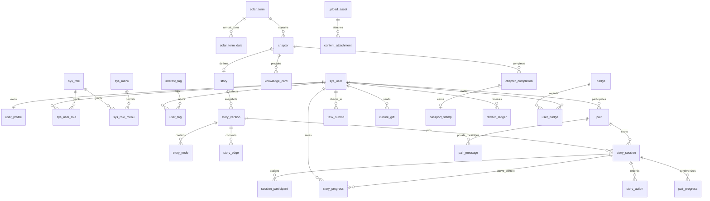
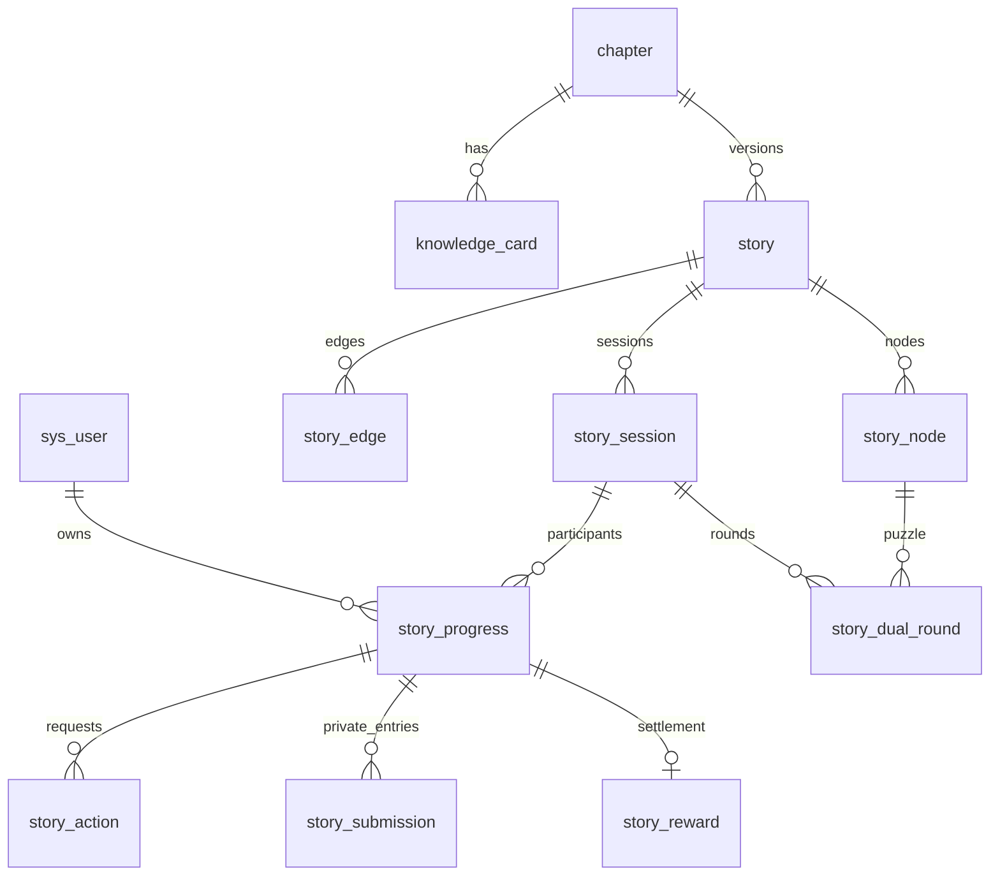

# 岁时同行数据库设计

这是阶段0完整逻辑设计。阶段1已实现身份/RBAC/档案/标签/审计SQL；本轮V3/V4新增篇章、知识卡、story/story_node/story_edge/story_progress及协作/动作/私有提交/奖励表。实际模型与差异见[剧情说明](story-engine.md)。其余规划业务表尚未创建，不把下文全部视为已落库。

## 1. 通用约定

- MySQL8.0、InnoDB、utf8mb4。中文展示内容使用 JSON `{zh,en}`；语言键可扩展，关键必填语言由发布校验。编码、用户名规范化字段使用确定大小写规则，不能完全依赖默认排序规则。
- 主键 `BIGINT` 雪花 ID，所有关联同类型；HTTP/JSON 输出字符串，避免 JavaScript 精度丢失。演示 seed 采用固定保留区 ID，不伪造线上用户。
- 通用列：`id`、`created_at DATETIME(3)`、`updated_at DATETIME(3)`；需要并发控制的聚合加 `version INT NOT NULL DEFAULT 0`。UTC 存储；年度节气为 DATE，单独注明运营时区。
- 核心关联加真实外键，默认 RESTRICT，无自动级联删除真实业务历史。注销采用匿名化与停用，按设计保留必要审计，不随意删奖励/协作账本。外键涉及多个上下文字段时用复合唯一键，禁止跨版本关联。
- JSON 用于多语言、有限变量和规则，不代替需要检索/唯一性的核心关系。JSON schema 在 Service 层校验，关键枚举同时用 CHECK。分页默认20、最大100。
- 金额/费率 DECIMAL，不用浮点；AI token 未知用 NULL。user_a/user_b 必须不同。密码只保存 BCrypt，不可逆；邮箱 AEAD 密文+HMAC 检索列，密钥独立注入。

## 2. 核心 ER

图只显示主要关系。pair 对 sys_user 有 user_a/user_b 两个外键；content_attachment 的业务所属由受控类型与对象 ID 校验，详见约束。知识卡发布修订不可原位改正文，故事版本保存引用及必要的知识快照，保证旧版解释可重现。

## 3. 用户 权限与系统表

| 表 | 主要字段 | 约束与索引 / 阶段 |
| --- | --- | --- |
| sys_user | username VARCHAR(64)、username_normalized VARCHAR(64)、email_enc VARBINARY(512)、email_lookup BINARY(32)、password_hash VARCHAR(100)、role_type、status、auth_version、adult_status、adult_confirmed_at、last_active_at | UNIQUE(username_normalized)、UNIQUE(email_lookup)；status 索引；role_type 只表达文化身份，管理员看 RBAC / 1 |
| user_profile | user_id、country VARCHAR(50) NULL、native_lang、learn_lang、lang_level JSON、timezone VARCHAR(64)、avail_slots JSON、privacy JSON、notification_preferences JSON | UNIQUE(user_id) FK；timezone 校验 IANA；语言等级0–5；时段为每周本地起止，服务端验证 / 1 |
| interest_tag | code VARCHAR(64)、name_i18n JSON、enabled | UNIQUE(code) / 1 |
| user_tag | user_id、tag_id | UNIQUE(user_id,tag_id)，反向(tag_id,user_id) / 1 |
| sys_role | code、name、enabled | UNIQUE(code)；GUIDE/PARTNER 与 ADMIN/EDITOR/REVIEWER 分离 / 1 |
| sys_menu | code、parent_id NULL、type、route、permission_code、sort_order、enabled | UNIQUE(code)；权限 code 唯一；后台菜单及方法权限，不信任客户端 route / 1、7 |
| sys_user_role / sys_role_menu | user_id+role_id / role_id+menu_id | 各关联唯一及外键 / 1 |
| user_identity | user_id、provider、app_id、subject、unionid NULL、verified_at | UNIQUE(provider,app_id,subject)；unionid 仅同开放平台范围关联；绑定需两边重新认证 / 8 |
| user_block | owner_id、blocked_user_id | UNIQUE(owner_id,blocked_user_id)，CHECK 不同用户 / 5 |
| sys_notice | title_i18n、content_i18n、status、published_at | (status,published_at) / 7 |
| sys_oper_log | actor_id、action、resource_type、resource_id、request_id、result、metadata_masked JSON | (actor_id,created_at)、(resource_type,resource_id)；不记录密钥、答案、聊天正文 / 1、7 |
| sys_login_log | user_id NULL、identifier_masked、channel、success、reason_code、ip_masked | (user_id,created_at)；不记录密码与完整邮箱 / 1 |
| sys_config | config_key、value_json、revision、updated_by | UNIQUE(config_key)，仅白名单键，禁止任意系统参数/密钥读取 / 1、7 |

新增 user_identity 用于微信独立适配及多渠道绑定；user_block 用于原文拉黑要求。未成年资格首版仅保存确认状态/时间，不采集身份证图片；生产需按实际使用场景完善资格验证，不能把自我勾选声称为实名核验。

## 4. 节气 内容与发布表

| 表 | 主要字段 | 约束与索引 / 阶段 |
| --- | --- | --- |
| solar_term | code VARCHAR(32)、ordinal TINYINT、name_i18n JSON、intro_i18n JSON、theme_color、mascot_asset_id NULL | UNIQUE(code)、UNIQUE(ordinal)，ordinal 1–24；按公历循环顺序小寒至冬至 / 2 |
| solar_term_date | term_id、year SMALLINT、start_date DATE、source_url VARCHAR(1000)、source_note TEXT、review_status、reviewer_id NULL、reviewed_at | UNIQUE(term_id,year)、UNIQUE(start_date)；CHECK 年份匹配日期；日期索引；按年度导入审校 / 2 |
| chapter | term_id、code、title_i18n JSON、intro_i18n JSON、cover_asset_id NULL、status、open_policy JSON | UNIQUE(code)、UNIQUE(term_id) 首版每节气1章；重复体验按年份与会话处理；不保存固定时间常量 / 2 |
| knowledge_card | chapter_id、logical_code、revision INT、title_i18n JSON、body_i18n JSON、sources JSON、region_note_i18n JSON、review_status、reviewer_id、reviewed_at、supersedes_id NULL | UNIQUE(chapter_id,logical_code,revision)；(chapter_id,review_status)；发布后的行不可改正文，修订生成新行 / 2 |
| terminology | code、text_i18n JSON、source_note、review_status | UNIQUE(code)，统一节气/习俗术语 / 2、7 |
| story | chapter_id、current_published_version_id NULL | UNIQUE(chapter_id)；一章一逻辑剧情，多发布版本 / 3 |
| story_version | story_id、version_no INT、schema_version INT、status、entry_node_id NULL、chapter_snapshot JSON、knowledge_snapshot JSON、variables_schema JSON、content_hash CHAR(64)、reviewed_by、published_at | UNIQUE(story_id,version_no)；(story_id,status)；PUBLISHED 不可变 / 3 |
| story_node | story_version_id、node_key VARCHAR(64)、node_type VARCHAR(16)、content_i18n JSON、config JSON、position_json JSON | UNIQUE(story_version_id,node_key)、UNIQUE(story_version_id,id)；type 六类 CHECK；config 是私有规则，运行端不直接序列化 / 3 |
| story_edge | story_version_id、from_node_id、to_node_id、option_key NULL、priority INT、condition_json JSON | UNIQUE(story_version_id,from_node_id,priority)；两端复合 FK 指向同版本节点 / 3 |

原文 solar_term.year/start_date 拆到 solar_term_date（D02）。原文 chapter.story_id 与 story.chapter_id 的双向关联合并成 story.chapter_id 唯一关系，发布指针放 story，避免循环一对一造成写入歧义。story 的发布指针与入口节点使用复合关联确保属于自己的剧情/版本；先插入空指针，再在发布事务校验并更新，不使用 MySQL 不支持的延迟外键。

## 5. 存档 协作与结算表

| 表 | 主要字段 | 约束与索引 / 阶段 |
| --- | --- | --- |
| story_session | story_version_id、chapter_id、season_year、pair_id NULL、mode、purpose、status、source_session_id NULL、checkpoint_key NULL、is_preview、closed_at | mode=SOLO/SCRIPTED/AI/HUMAN；purpose=PRIMARY/REPLAY/PREVIEW；(pair_id,status)；版本和篇章一致；真实会话与预览隔离 / 3–4 |
| session_participant | session_id、slot CHAR(1)、user_id NULL、participant_type、joined_at、left_at | UNIQUE(session_id,slot)、UNIQUE(session_id,user_id)；HUMAN 必须有真实 user_id，AI/SCRIPTED 必须为空；只读保留退出历史 / 4 |
| story_progress | user_id、chapter_id、season_year、session_id、story_version_id、current_node_id、variables JSON、history_summary JSON、status、version | UNIQUE(user_id,chapter_id,season_year)；current_node 复合 FK 到固定版本；(session_id,status)；切换仅更新本人的活动会话指针 / 3 |
| story_action | session_id、user_id、node_id、visit_no、action_type、request_id VARCHAR(64)、payload_hash CHAR(64)、submitted_payload JSON、result_snapshot JSON、version_before、version_after | UNIQUE(session_id,user_id,request_id)；(session_id,node_id,visit_no)；敏感答案只限服务端与审计，响应快照必须已脱敏 / 3 |
| pair_progress | session_id、pair_id NULL、story_version_id、node_id、visit_no INT、a_answer JSON NULL、b_answer JSON NULL、a_submitted_at、b_submitted_at、state、deadline、extension_count、a_skip_confirmed、b_skip_confirmed、resolution_type、result_json JSON NULL、judged_at、version | UNIQUE(session_id,node_id,visit_no)；(state,deadline)；答案、结果仅服务端；stateVersion 条件更新；AI/script 用同一结构 / 4 |
| chapter_completion | user_id、chapter_id、season_year、session_id、ending_node_id、story_version_id、completion_type、completed_at、in_season | UNIQUE(user_id,chapter_id,season_year)；终结状态不可覆盖；真实完成才写 / 3、6 |
| reward_ledger | user_id、pair_id NULL、session_id、event_type、event_id、reward_type、rule_version、amount INT、payload JSON | UNIQUE(user_id,event_type,event_id,reward_type)；(pair_id,created_at)；不可变，修正写冲销事件，不改旧金额 / 3、6 |
| passport_stamp | user_id、term_id、chapter_id、season_year、completion_id、in_season、awarded_at | UNIQUE(user_id,term_id,season_year)、UNIQUE(completion_id)；completion FK；没有用户侧“发印章”接口 / 6 |
| badge | code、revision、name_i18n JSON、rule_json JSON、enabled | UNIQUE(code,revision)，规则白名单化；发布规则不可原位改 / 6 |
| user_badge | user_id、badge_id、scope_key、source_event_id、awarded_at | UNIQUE(user_id,badge_id,scope_key)，scope_key 非空（年度或全局） / 6 |

已完成篇章可开始REPLAY练习会话，当前练习存档可以更新，但首次chapter_completion与印章不覆盖、不重复奖励；岁时册完成状态查完成表而非当前练习状态。SOLO节点规则只用于单人练习判定，HUMAN的A/B答案不得借模式字段切换后读取。

这些新增表的原因：story_version 防旧存档失效；story_session/session_participant 确定协作与 AI 上下文；story_action 实现幂等和动作可追溯；chapter_completion/reward_ledger 为真实奖励提供唯一依据。story_progress.history_summary 只作展示摘要，不能替代 action 账本。

真人两人的个人进度可独立阅读，但在 dual 汇合。pair_progress 的唯一键不能只用 pair_id/node_id，因为同一关系可跨年、跨版本、重玩；也不能用单独的 requestId 防止两人并发结算，必须有业务行锁与奖励唯一键。

## 6. 结对 文化 审核与文件表

| 表 | 主要字段 | 约束与索引 / 阶段 |
| --- | --- | --- |
| pair | user_a、user_b、user_low、user_high、inviter_id、status、invite_expires_at、accepted_at、dissolved_at、harmony、version、active_key | user_low/high=双方规范排序；CHECK 不同用户；活动邀请/结对的 active_key 非空且 UNIQUE，解除/拒绝后 NULL；(user_a,status)、(user_b,status) / 5 |
| pair_message | pair_id、sender_id、client_message_id、message_type、body TEXT NULL、audit_status、visible_at NULL | UNIQUE(pair_id,sender_id,client_message_id)；(pair_id,audit_status,id) 游标读取；发送者必须为活跃成员 / 5 |
| task_submit | user_id、chapter_id、session_id、node_id、revision、note TEXT、audit_status、public_requested、reviewed_at、version | (user_id,chapter_id)、(audit_status,created_at)；节点任务满足查询按当前有效审核修订 / 6 |
| culture_gift | pair_id NULL、session_id、chapter_id、node_id、user_id NULL、author_type、content_i18n JSON、original_language、translation_status、tags JSON、audit_status、public_requested、revision、version | author_type HUMAN/AI/SCRIPTED；真实作者必须有 user_id；翻译不代替原文，未校对须标识；(session_id,node_id)、(audit_status,created_at) / 6 |
| gift_interaction | gift_id、actor_id、interaction_type、message_id NULL | UNIQUE(gift_id,actor_id,interaction_type)；不能靠重复点赞刷默契 / 6 |
| upload_asset | owner_id、bucket、object_key、original_name_masked、mime_type、size_bytes、sha256、purpose、status、audit_status、expires_at NULL | UNIQUE(bucket,object_key)、(owner_id,created_at)；私有对象权限由数据库判断 / 6 |
| content_attachment | asset_id、target_type、target_id、sort_order | UNIQUE(target_type,target_id,asset_id)；target_type 白名单 TASK/GIFT/MESSAGE/CONTENT；业务层确认对象存在及同一所有者，不能接受任意 ID / 5–7 |
| showcase | content_type、content_id、featured_by、status、published_at | UNIQUE(content_type,content_id)；仅已审核且用户公开同意的真人内容，AI 禁止入选 / 7 |
| showcase_like | showcase_id、user_id | UNIQUE(showcase_id,user_id)；点赞可撤回，与默契规则分离 / 7 |
| audit_record | target_type、target_id、target_revision、stage、status、reviewer_id NULL、reason_code、comment_masked、source_hash | (target_type,target_id,target_revision)、(status,created_at)；机器未知不能写通过；支持文化/双语/安全/公开复核的独立留痕 / 6–7 |
| sensitive_word | term、category、action、enabled | 规范词条唯一；敏感匹配不得替代所有人工审核 / 6–7 |
| report | reporter_id、target_type、target_id、reason_code、description_masked、status、handled_by、handled_at | (status,created_at)、(reporter_id,created_at)；举报附件复用上传权限 / 5、7 |

原表的 photo_key/media_key 改由 content_attachment 支持多图片与语音，避免用一个 VARCHAR 假装支持多附件。正文审核修订与附件审核均通过后才展示；撤回公开时下线 showcase 并使新签发下载地址失效。

pair.status完整枚举为INVITED/ACTIVE/REJECTED/CANCELLED/EXPIRED/DISSOLVING/DISSOLVED；DISSOLVING保留活动唯一键阻止封存期间重复建对，但从开始即拒绝私密访问。关系处理完成后才释放唯一键。

## 7. AI与统计表

| 表 | 主要字段 | 约束与索引 / 阶段 |
| --- | --- | --- |
| ai_config | provider_name、base_url、model、secret_ref、timeout_ms、temperature DECIMAL、daily_limit、max_rounds、max_output_tokens、enabled、revision、updated_by | P0 不存 api_key_enc；secret_ref 限定后端预注册引用；base_url 限定批准的 HTTPS 域名，禁止用户任意内网请求 / 4、7 |
| ai_persona | code、name_i18n JSON、style_prompt TEXT、boundary_prompt TEXT、chapter_id NULL、revision、enabled | UNIQUE(code,revision)；只限后台配置，公开 VO 不返 prompt / 4 |
| ai_chat_log | conversation_id、request_id、session_id、pair_id NULL、user_id、node_id、role、content_masked TEXT NULL、flags JSON、audit_status、provider、model、status、fallback_reason、tokens_in NULL、tokens_out NULL、latency_ms、cost_estimate DECIMAL NULL | (user_id,created_at)、(conversation_id,id)、UNIQUE(conversation_id,request_id,role)；默认不落聊天原文；每次调用即使降级也有状态和耗时 / 4 |
| stat_event | event_key、event_type、user_id NULL、chapter_id NULL、pair_id NULL、is_demo、occurred_at、dimensions JSON | UNIQUE(event_key)；(event_type,occurred_at)、(user_id,occurred_at)；不记录消息正文和邮箱 / 7 |
| stat_daily | stat_date、metric、dimension_key、is_demo、value DECIMAL、generated_at | UNIQUE(stat_date,metric,dimension_key,is_demo)；聚合可重算，国别统计尊重隐私与未知类别 / 7 |
| outbox_event | event_type、aggregate_type、aggregate_id、dedup_key、payload JSON、status、attempts、next_retry_at、delivered_at | UNIQUE(dedup_key)、(status,next_retry_at)；业务事务内写，外部通知失败不回滚业务 / 4–7 |

AI 对话历史恢复所需的短期文本可在受控会话存储中加密且设置 TTL；业务日志仅脱敏摘要。P0 默认保留周期为诊断元数据30天、临时文件24小时（工程默认，生产前按实际政策审定）；注销请求使本人不再参与推荐，清理或匿名化个人信息与对话。

## 8. 事务与索引实施规则

### 8.1 推进与幂等

幂等作用域为当前用户、session 与 requestId。请求体规范化计算 payload_hash；同键不同内容返回409。已成功动作先返回 result_snapshot；未成功事务不留半条动作。`UPDATE story_progress SET ...,version=version+1 WHERE id=? AND version=?` 影响0行即版本冲突，返回当前 revision 让客户端刷新。

同一节点可重复点击而不重复发奖，因为 reward_ledger 与 completion 的业务唯一键独立于 requestId。客户端改 requestId 不会绕过节点/版本校验。

### 8.2 协作判定

以 `(session_id,node_id,visit_no)` 插入或读取协作行；真人流程先锁pair并确认ACTIVE→锁协作行→按用户ID排序锁存档→校验→写提交→一次判定→写动作/结算→outbox→提交。AI/单人会话无pair时跳过pair锁。所有协作路径、超时扫描和解除流程遵循一致锁序；不得某条路径先锁存档再锁协作行。接受邀请的双方用户锁位于pair锁之前，不在协作判定中反向锁用户行。

为结对解除，先条件设置 pair 为 DISSOLVING 撤销新写请求，之后按 session/协作行顺序封存，最后 DISSOLVED；读权限从 DISSOLVING 即撤销，补偿任务可完成中断的封存。不持有用户行锁发网络请求。

时间边界统一以事务中获得锁后的 Clock 时间为准。数据库 `state/version` 条件更新与 `UNIQUE` 同时使用，不能把 Redis 分布式锁当成防重复奖励的唯一手段。

### 8.3 结对额度

accept 先按用户 ID 顺序锁双方 sys_user，再检查 active pair 数<3、成年/封禁/拉黑与邀请时效，最后修改 pair。所有涉及新增活跃关系的路径都走同一服务；推荐缓存不能作为接受时的配额依据。

### 8.4 查询索引

- 当前节气：solar_term_date(start_date)，读当前日前最近一条与下一条，覆盖跨年。
- 存档恢复：story_progress(user_id,chapter_id,season_year) 唯一索引；状态读取必须附 user_id。
- 协作过期：pair_progress(state,deadline)，批量扫描、短事务，可重试。
- 留言：pair_message(pair_id,audit_status,id)，游标分页不使用深 offset。
- 审核：业务待审状态与 created_at，按队列翻页；audit_record 提供修订审计。
- 岁时册：passport_stamp(user_id,season_year,term_id)；completion 作为真实性依据。
- 统计：stat_daily 唯一维度读取；大屏禁止请求时全表聚合。

## 9. Redis键与持久化边界

| 键前缀 | 用途 | 生命周期与降级 |
| --- | --- | --- |
| auth:refresh / auth:revoked | refresh 哈希、注销和令牌撤销 | refresh 默认7天、access15分钟；Redis AOF；缓存故障拒绝刷新，禁用检查仍读数据库 auth_version |
| rate:login / rate:ai | 登录尝试及模型额度 | 原子计数+过期；Redis故障模型降脚本，登录采用保守本地限流，单实例比赛部署 |
| term:calendar:{year}:{revision} | 已审年度日历 | 1h TTL+版本失效，未命中读DB |
| story:public:{version}:{node}:{slot}:{lang} | 已脱敏静态节点投影 | 不缓存用户答案；session权限每次检查 |
| pair:recommend:{user}:{ruleVersion} | Top-K候选 | 默认10分钟；接受邀请必须重查DB |
| ai:faq:{personaRev}:{contentRev}:{mode}:{slot}:{lang}:{questionHash} | 审核过的通用答复 | 仅无私密历史的通用问答可跨用户缓存；否则加 user/session 作用域 |
| stat:overview:{scope}:{revision} | 统计只读缓存 | 60秒；附生成时间；数据分真/演示 |

## 10. 初始化与种子验收

阶段1提交最小系统/RBAC迁移、开发专用用户种子与可重跑说明；阶段2提交24节气定义、年度日期导入模板与四章知识草稿。日期必须有已核验来源和审校状态，不能以固定“每年2月4日”生成。无已审当年数据时接口给明确未配置状态，不偷偷推算。

阶段3后提交六类型图 schema 示例、四章的节点/边/分支与引用；正确集合作为私有 seed，不进入 `web/public` 或客户端构建。阶段4加入两真实账号测试协作；阶段7补齐内容审校发布和统计；阶段9在全新数据库迁移、重复运行 seed、恢复备份后核验双账号、旧存档与印章唯一性。

演示数据所有用户/事件带显式标识；管理员账号密码在初始化时从环境变量读取并 BCrypt，不能在生产迁移中固化统一口令。正式 SQL、执行日志和 ER 变更必须随实现更新本文。

## 本轮已落库关系（V3/V4）

精确DDL为V3__story_engine.sql；本轮的不可变story版本、篇章级奖励唯一、私有文字完成条件与未来年度/公开审核设计的区别见[新增设计说明](story-engine.md)。未来正式年度印章需要新增迁移，不修改已执行V3/V4。

## 本轮AI落库（V5）

ai_config只含非敏感参数，不含密钥；ai_persona保存固定小满双语风格。ai_knowledge_review以card_id、正文和出处摘要绑定管理员审校。ai_chat_log保存脱敏对话、幂等请求摘要、上下文摘要、来源、原因、尝试/耗时/token；ai_usage_daily与ai_usage_progress分别持久化UTC每日尝试和篇章轮数。日志关联真实用户/进度/节点，权限由后端判断。详见[AI说明](ai-companion.md)。

## V6剧情编辑器实际迁移（2026-10-29）

- story_editor_draft：chapter_id主键，revision、graph_json、updated_by/at；每篇章一份可变草稿，持久化节点位置与图内字符串标识。
- story_publication：story_id主键关联不可变story；chapter_id+draft_revision唯一，记录编辑图快照、发布账号、说明和UTC时间；重复发布同revision不重复建图。初始V4种子版本没有虚构发布账号或审校记录。
- story_editor_preview：UUID主键、owner_id、chapter_id、独立graph_json/state_json、revision和expires_at；只保存管理员预览，不关联用户进度或奖励。过期读取拒绝，启动预览时按索引分批清理。
- actor/owner账号ID按sys_oper_log相同策略保留逻辑引用，不加账号删除外键；正式隐私留存/匿名化策略仍待后续交付验收。
- sys_menu新增story:read/write/preview/publish，关联ADMIN、EDITOR、REVIEWER；未修改V1–V5迁移。

发布仍写原story/node/edge表；以chapter行锁保证同章版本分配，draft revision防覆盖，事务内重新分配所有运行节点/连线ID并保存快照与审校说明。现有story_progress.story_id不迁移。独立篇章复制知识卡时生成新ID且只标SOURCE_CHECKED，不复制AI审校批准。

详见[编辑器文档](story-editor.md)和[验证](testing/editor-validation.md)。
