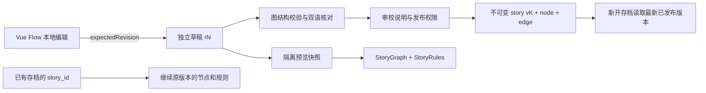

# Vue Flow 真实剧情编辑器

2026-10-29。入口：`http://127.0.0.1:5173/admin/stories`。使用管理端账号登录；已经登录的旧页面请刷新，以读取V6新增权限。实现基于现有工程，使用 Vue Flow 1.48.2（MIT）和原有 Spring Boot / MyBatis-Plus / MySQL。

## 使用流程

1. 选中篇章，加载数据库草稿；尚无草稿时从最新发布版本生成编辑视图。立春初始图为14节点、22条边。
2. 左侧六种组件可拖入画布或点击添加；中间支持平移、缩放、节点拖动、动作端点连线和节点/连线选择。节点目录可定位远处节点，工具栏可适应全图。
3. 右侧修改中英标题/正文、线索、选项、变量、反馈或判定参数。点击空白处编辑起点和初始变量；选中连线编辑目标、动作、条件和优先级。节点属性下方也可直接选择该节点的出边。
4. 保存草稿。空白正文、未连完分支等语义不完整内容可以保存，格式错误或重复标识会拒绝。保存不会影响用户。
5. 校验图结构，按问题位置修正。保存后才能运行固定快照预览或发布，避免把本地未保存内容误当成已发布内容。
6. 预览选择A/B视角，从起点执行真实服务端分支与变量规则；dual节点由管理员显式输入双方测试答案。预览不是两个真人的异步会话，不会写用户进度、打卡或印章。
7. 发布前逐项核对文化依据、中英文本和分支，勾选两项核对声明，填写真实发布说明。发布创建新版本；审校记录表示操作账号的声明，不代表已经取得专家认证。
8. 版本记录可复制历史版本为新草稿；不会改写历史版本或回退用户存档，恢复后仍需审校发布。

需要安全联调时，先“新建篇章”，复制已有发布图和知识卡；新篇章保持DRAFT，发布后才开放。测试代码可用`ED_...`并明确命名为测试。完成后归档，保留测试证据，禁止冒充正式文化内容。复制知识卡只继承出处和正文，**不继承AI知识审校授权**。任意测试代码不自动成为二十四节气分类或年度日期数据。

## 草稿与发布规则



- 草稿每个篇章一份，以revision乐观锁防止覆盖；同篇章保存/发布再用chapter行锁串行化。409时界面保留本地修改，重新加载需要明确确认。
- 每个发布版本重新生成全局节点/连线ID，写入原来的`story`、`story_node`、`story_edge`，因此原`StoryService`直接读取，没有独立“演示引擎”或前端假图。
- 同一草稿revision重复发布返回既有发布结果，不重复创建版本。事务保证图、快照、审校说明和操作日志一起提交。
- 保留全部历史`story`行，已有`story_progress.story_id`不变。发布不会迁移/覆盖进度，也不会提前结算奖励。
- 归档只阻止新用户开始并从公开篇章列表移除；已有存档、知识卡、版本记录与草稿保留。已归档篇章仍可在编辑器修改，并通过新版本重新发布。

## 节点参数

| 类型 | 可编辑内容与规则 | 正式引擎行为 |
| --- | --- | --- |
| narrative | 中英标题/正文，effects | continue后更新变量并选边 |
| choice | 中英选项、每项effects和可选双语反馈 | 只接受当前选项动作 |
| dual | clueA/clueB、optionsA/optionsB、答案、解释、协作窗口和分数 | 只向用户投影本侧内容；第二人提交后服务端判定 |
| gift / checkin | 中英提示、effects | 原有私有文本提交；至少一种语言5–2000字符 |
| ending | 中英结局；节点标识成为结局key | 无出边，finish由服务端发放唯一篇章印章 |

变量仍只有`knowledge`、`harmony`、`care`。初始值0–10000；单次effects为-100至100整数，应用后截断到0–10000。

dual参数：`windowHours`默认48、可配置1–168；`harmonyBase`默认10、`harmonyBonus`默认5、`knowledgeBonus`默认1，均可配置0–100。正确时增加基础默契+额外默契及知识，错误时仅基础默契，超时跳过不加分。旧版本没有这些字段时保持原来的15/10分行为。延长操作仍明确增加48小时，缺席真人不会被脚本替代操作自动推进。

边的`action`必须属于来源节点。条件只接受`{var, op, value}`整数DSL，op为eq/ne/gte/gt/lte/lt。每个动作必须有且只有一条无条件默认边；有条件边优先级更高，同一动作下优先级唯一。拒绝环路、悬空边、不可达节点、无出口、结局出边、漏译、非法选项/答案及未知引擎参数，不执行JavaScript、SQL、SpEL或模型判断。

选项创建时生成标识；移除选项后需调整对应连线并重新校验。高级JSON只编辑支持的config参数，不意味着任意扩展参数都会生效。当前没有上传/公开审核的引擎实现，添加gift/checkin不会悄悄启用这些能力。

## 接口

均为真实后端接口，复用Result、JWT、全局异常与traceId。前缀`/api/admin/story`。

| 方法 | 路径 | 权限/用途 |
| --- | --- | --- |
| GET | /chapters | story:read；包含DRAFT/PUBLISHED/ARCHIVED |
| POST | /chapters | story:write；创建独立篇章，复制来源图和知识卡 |
| GET | /chapters/{id}/draft | story:read；加载草稿及revision |
| PUT | /chapters/{id}/draft | story:write；expectedRevision+graph |
| POST | /validate | story:read；校验当前图，返回valid和issues |
| POST | /chapters/{id}/preview | story:preview；固定已保存revision，指定A/B |
| GET | /previews/{token} | story:preview；仅预览创建者，过期404 |
| POST | /previews/{token}/step | story:preview；expectedRevision、action及节点所需数据 |
| POST | /chapters/{id}/publish | story:publish；revision、两项核对声明、note |
| GET | /chapters/{id}/versions | story:read；版本、发布账号、说明、时间 |
| GET | /chapters/{id}/versions/{storyId} | story:read；指定版本图，仅允许本篇章版本 |
| POST | /chapters/{id}/restore | story:write；版本复制为新草稿 |
| POST | /chapters/{id}/archive | story:publish；归档篇章 |

草稿图结构：

```json
{
  "startNode": "opening",
  "initialVariables": {"knowledge": 0, "harmony": 0, "care": 0},
  "nodes": [
    {"id":"opening","type":"narrative","position":{"x":0,"y":0},"content":{"title":{"zh":"春信","en":"A spring letter"},"body":{"zh":"翻开一封春信。","en":"Open a letter of spring."}},"config":{"effects":{"care":1}}},
    {"id":"spring_returns","type":"ending","position":{"x":300,"y":0},"content":{"title":{"zh":"春回","en":"Spring returns"},"body":{"zh":"记住这次相遇。","en":"Keep this meeting in your memory."}},"config":{}}
  ],
  "edges": [{"id":"edge1","source":"opening","target":"spring_returns","action":"continue","priority":0,"condition":{}}]
}
```

id是图内稳定字符串标识；发布时映射为全局数据库ID。最多200节点、800边、1MB内容；中英标题200字符、正文10000字符、选项20个。节点坐标持久化，不依赖前端内存。

## 权限与安全

| 身份 | 读取 | 保存 | 预览 | 发布 |
| --- | --- | --- | --- | --- |
| ADMIN | 是 | 是 | 是 | 是 |
| EDITOR | 是 | 是 | 是 | 否 |
| REVIEWER | 是 | 否 | 是 | 是 |
| 普通用户 | 否 | 否 | 否 | 否 |

编辑/审核角色由现有RBAC分配，不提供普通注册提权接口。管理端接口还要求admin渠道JWT。Vue路由守卫仅做界面防护，服务端独立检查每一项权限。

管理员才能读取完整图及答案。用户端依旧只取得当前节点、自己视角的线索/选项，模型上下文仍不包含答案配置。预览在`story_editor_preview`保存一小时，按创建账号校验归属与版本；过期读取失败，创建时分批清理过期快照。预览中的另一侧选项只出现在有权限的管理预览，不下发到用户端。

数据库新增V6，新增设计及原因：独立草稿防止改坏线上图，发布快照保留布局与审校说明，预览表隔离奖励与真实游戏；独立测试篇章/归档用于验证发布链而不覆盖立春。参见 [数据库设计](database-design.md)、[测试与截图](testing/editor-validation.md)。

Vue Flow API与交互参考[官方基础示例](https://vueflow.dev/examples/)和[官方文档](https://vueflow.dev/guide/)，实际锁定版本及MIT许可来自安装包元数据。
