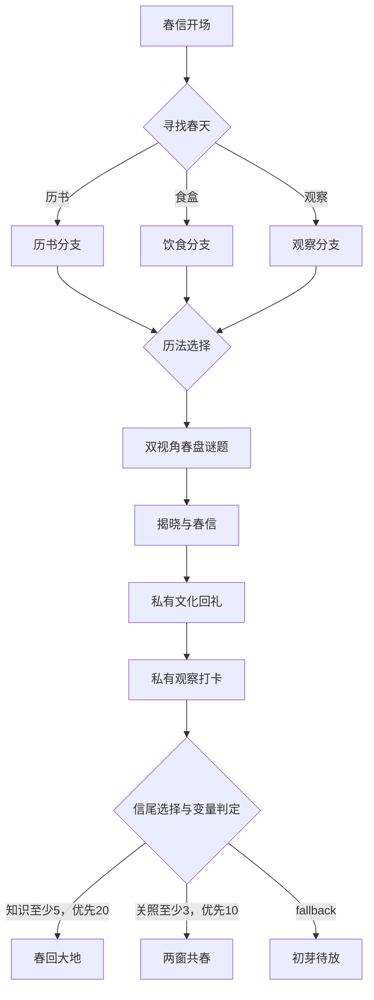

# 剧情引擎：当前实现与验收边界

2026-10-28，按用户本轮明确要求，在现有阶段1工程上优先实现剧情引擎和立春篇章，没有重建项目。原计划阶段2的全年节气日历、年度日期维护等仍未完成。

## 运行与体验

按[日常运行指南](run-guide.md)启动。新后端首次启动时，Flyway自动执行V3/V4，保留原用户和档案。登录后点击首页/顶部“立春篇章”，或访问`http://127.0.0.1:5173/stories/1`。

- 单人：选择“小满脚本伙伴”，服务端提供另一视角的脚本提交，无模型密钥也能通关。
- 双人：已确认成年的GUIDE账号选择真人模式，将32位随机邀请代码交给已确认成年的PARTNER；对方在独立浏览器/隐身窗口登录，在未开始的立春页面接受。
- 同一用户、篇章仅一份存档。再次开始返回原存档，不覆盖分支或重置奖励。
- 两人独立推进自己的分支，在同一dual节点汇合。先交者等待，第二份提交后统一判定，双方再次读取即可恢复更新后的节点。
- 每次提交即入库，刷新通过GET恢复，浏览器内存不是存档依据。

## 数据模型与新增设计

| 表 | 用途 |
| --- | --- |
| chapter / knowledge_card | 最小篇章入口和带出处的双语知识卡；无年度日期 |
| story | 每行一个不可变发布版本，`(chapter_id,version)`唯一 |
| story_node / story_edge | 六类节点、私有配置、条件与优先级连线，复合外键阻止跨剧情连线 |
| story_progress | 用户、篇章、固定story版本、当前节点、变量、历史、状态、修订号 |
| story_session | 篇章内双方接受的协作会话及邀请，与未来通用结对区分 |
| story_dual_round | 每会话每节点唯一，双方答案、48小时截止、判定与延长标志 |
| story_action | 每存档每requestId唯一，保存请求摘要，防重复及改内容重放 |
| story_submission | gift/checkin私有文字，双语可选，不自动发给伙伴或发布 |
| story_reward | 真实ending结算产生的唯一印章记录，区分真人/脚本来源 |

文档以tinyint列举节点，本实现存六种字符串并有数据库CHECK，便于接口、调试和编辑器一致。版本直接存为不可变`story`行，避免重复版本表。接口id为`chapter_id`，存档固定`story_id`，新发布不移动旧存档。

## 状态机与安全

- narrative只接受continue；choice只接受当前公开选项id；gift/checkin只接受submit及私有文字；ending只接受finish。
- dual只接受自己的选项，不能填写另一视角答案。答案、分支、变量、默契和印章均在服务端判定。
- DTO拒绝未知字段；客户端注入变量、奖励或目标节点会失败。没有直接跳转目标节点的接口。
- expectedVersion和nodeId必须匹配当前存档。过期页面、非法跳转、再次改答案返回409；未知选项、空白/过短记录返回400。
- 相同requestId和相同内容重试不重复应用，返回**当前最新状态**，不回放旧快照；相同编号改内容返回409。失败事务不写成功账本。
- 写操作按“会话行锁 → 存档行锁”串行；判定锁定双方存档，两份推进与答案同一事务提交。修订号用于客户端并发校验。
- 等待时只返回自己的线索/选项、已交状态及截止时间，不返回另一人线索/答案、答案字段或完整图。
- StoryView是显式玩家投影，实体和节点config不直接序列化。
- 结束结算与状态更新同一事务，`(user_id,chapter_id)`唯一，防重复奖励。仅完成记录印章，不冒称已完成整个岁时册。

条件DSL示例：

```json
{"var":"knowledge","op":"gte","value":5}
```

只允许knowledge/harmony/care和eq/ne/gte/gt/lte/lt整数比较，空对象为fallback，按优先级降序选中。禁止SpEL、JavaScript和SQL表达式。变量单次增量-100到100，累计0到10000。加载时校验类型、双语、选项、答案域、归属、可达性、无环、终点和fallback。

## 双视角、48小时与迟交

首人进入dual时创建持久化48小时窗口。`OPEN → WAITING_PARTNER → JUDGED`，到期读取/提交时转为TIMEOUT；仍可补交，两份齐备正常判定。

超时后可延长48小时（每轮一次）；或切换脚本伙伴，仅把请求人迁入新脚本会话，保留其原答案，未提交者仍须自己作答；或跳过，仅推进请求人、不加默契。缺席真人不会自动推进或获奖。

非跳过判定给10基础默契，组合命中加5，命中增加1知识。真人/脚本来源单独记录，属于本篇章变量，不写入尚未实现的通用排行。私有回礼不是双方互动，因此不虚增“回礼互动次数×5”。

## 立春剧情图



## 当前AI补充

小满中英对话、OpenAI兼容服务与脚本降级现已接入，本人线索/虚拟伙伴线索的授权区别见[AI说明](ai-companion.md)。对话不调用剧情推进或奖励接口。

## 尚未实现

图片/语音、公开审核与伙伴分享、通用推荐/结对/留言、WebSocket/外部提醒、可视化发布编辑器、年度日期/应时徽章、完整岁时册和其他三个季节篇章。双人通过4秒轮询及重新打开恢复，不假称已接入推送。

文化依据见[来源记录](content/lichun-sources.md)，验证见[剧情测试报告](testing/story-validation.md)。
